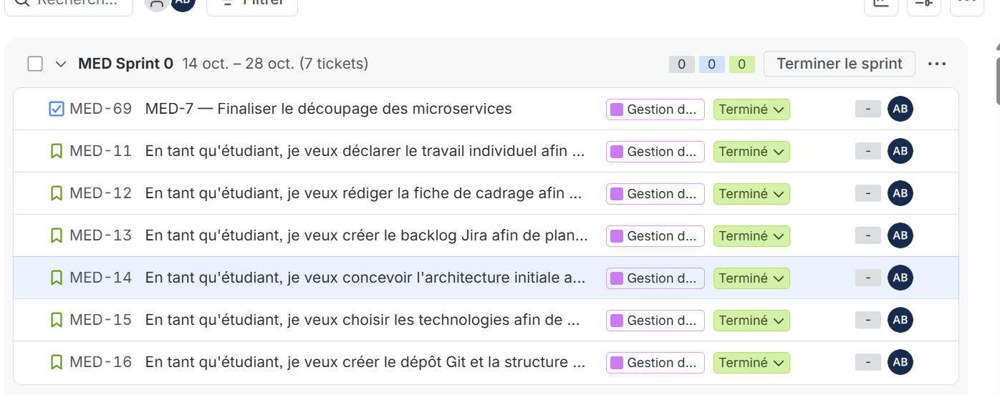
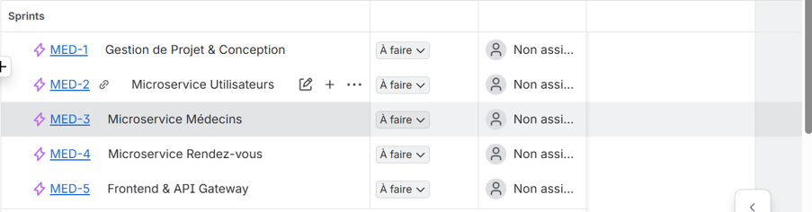
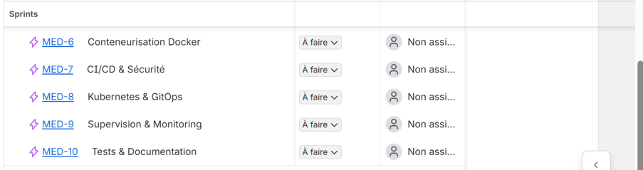
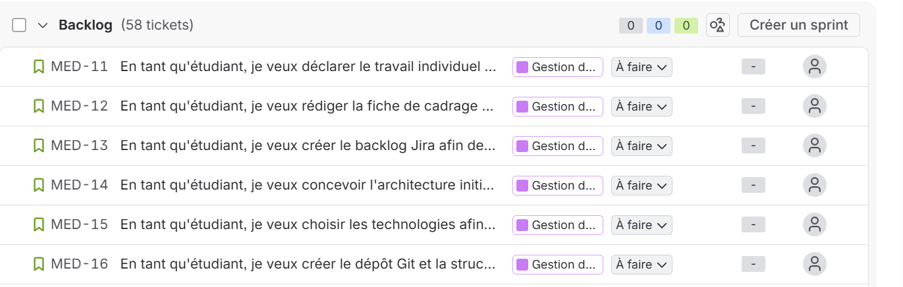
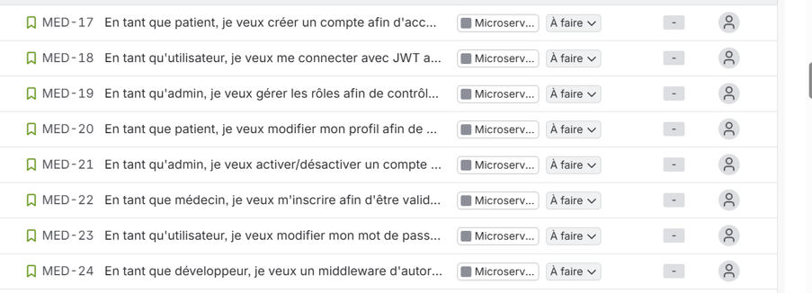
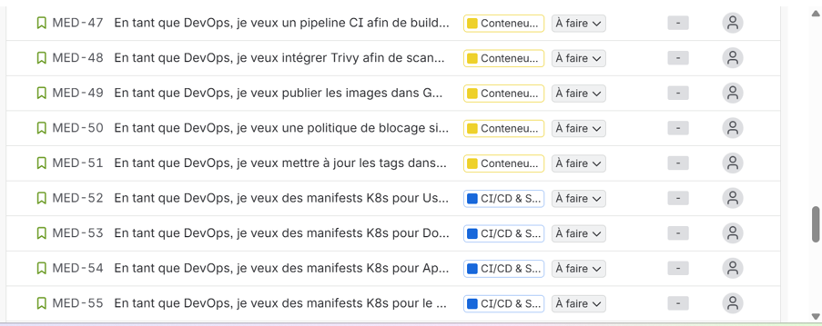

# 🏥 MediLink — Plateforme de gestion des rendez-vous médicaux

## 📋 Présentation du projet

**MediLink** est une application web de prise de rendez-vous médicaux conçue selon une **architecture microservices**. Ce projet s'inscrit dans le cadre du Master DevOps & Cloud (ISET Tozeur, Année universitaire 2026/2027).

L'objectif principal n'est pas seulement de développer l'application médicale, mais surtout de mettre en œuvre une **chaîne DevOps automatisée de bout en bout** : de la planification Agile jusqu'à la supervision en production, en passant par l'intégration continue, la conteneurisation et le déploiement GitOps.

## 🎯 Objectifs fonctionnels

- Simplifier la prise de rendez-vous médicaux en ligne.
- Permettre aux patients de gérer leurs profils, rendez-vous et prescriptions.
- Permettre aux médecins de gérer leurs horaires, disponibilités et patients.
- Offrir à l'administrateur un contrôle total sur les comptes et les statistiques.
- Garantir la confidentialité et la sécurité des données médicales.

## 🏗️ Architecture Microservices

Le projet repose sur **3 microservices indépendants** :

| Microservice | Responsabilités | Base de données |
|---|---|---|
| **User Service** | Authentification (JWT), rôles (Patient, Médecin, Admin), profils | PostgreSQL |
| **Doctor Service** | Profils professionnels, spécialités, horaires, prescriptions | PostgreSQL |
| **Appointment Service** | Cycle de vie des RDV, anti-double réservation, historique | PostgreSQL |

**Composants transverses :**
- **Frontend Web** : Interface utilisateur (React).
- **API Gateway** : Point d'entrée unique, routage et vérification JWT.

## 🛠️ Stack Technique

| Catégorie | Technologie |
|---|---|
| **Frontend** | React (Vite) |
| **Backend** | NestJS (Node.js) |
| **Base de données** | PostgreSQL |
| **Conteneurisation** | Docker |
| **CI/CD** | GitHub Actions |
| **Sécurité** | Trivy |
| **Registre d'images** | GHCR (GitHub Container Registry) |
| **Orchestration** | Kubernetes (Minikube) |
| **GitOps** | ArgoCD |
| **Monitoring** | Prometheus + Grafana |
| **Gestion de projet** | Jira (Scrum) |

## 🚀 Pipeline DevOps (GitOps)

Le pipeline est entièrement automatisé :

1. **Développement** : Commit / Push sur GitHub.
2. **Intégration Continue (CI)** : GitHub Actions déclenche le build et les tests.
3. **Conteneurisation** : Construction des images Docker.
4. **Sécurité** : Scan des vulnérabilités avec Trivy (blocage si critique).
5. **Publication** : Push des images sur GHCR.
6. **GitOps** : Mise à jour des manifests Kubernetes dans le dépôt GitOps.
7. **Déploiement Continu (CD)** : ArgoCD synchronise le cluster Kubernetes.
8. **Supervision** : Prometheus collecte les métriques, Grafana les visualise.

## 📸 Captures d'écran Jira (Gestion de projet)

### Sprint 0 — Cadrage & Conception

### Epics du projet

### User Stories (Exemples)

## 📚 Documentation

Toute la documentation technique est disponible dans le dossier [`docs/`](./docs) :
- [Architecture des microservices](./docs/architecture.md)
- [Choix technologiques](./docs/tech-stack.md)
- [Diagrammes d'architecture](./docs/diagrams/)

## 📈 Avancement du projet (Sprints)

- [x] **Sprint 0** : Cadrage, backlog Jira, architecture, choix technos, dépôt Git.
- [ ] **Sprint 1** : Développement du User Service (Auth, JWT, profils).
- [ ] **Sprint 2** : Développement du Doctor Service.
- [ ] **Sprint 3** : Développement du Appointment Service.
- [ ] **Sprint 4** : Conteneurisation Docker & CI/CD.
- [ ] **Sprint 5** : Déploiement Kubernetes & ArgoCD (GitOps).
- [ ] **Sprint 6** : Supervision (Prometheus / Grafana) & finalisation.

## 👤 Auteur

**Arij Belaid**  
Étudiant en Master DevOps & Cloud — ISET Tozeur  
*Projet réalisé individuellement.*

## 📄 Licence

Ce projet est sous licence MIT. Voir le fichier `LICENSE` pour plus de détails.
